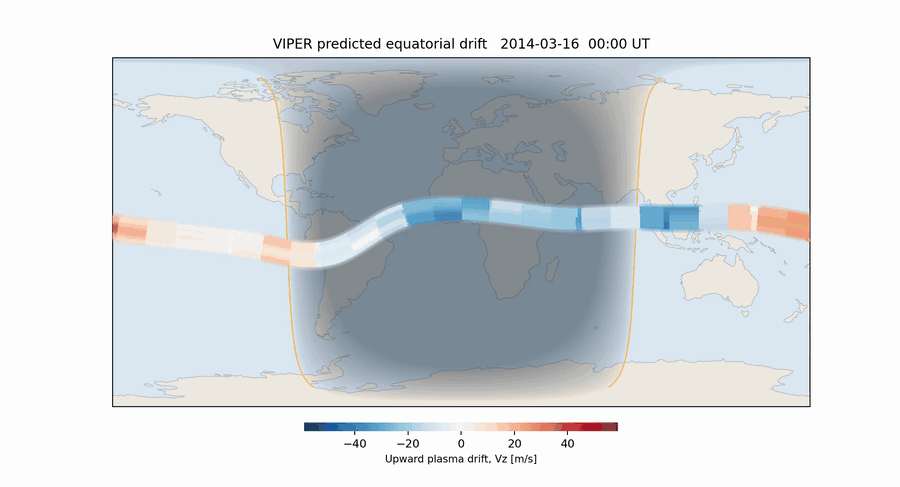

# VIPER

**VIPER** is a neural network that predicts **equatorial vertical plasma drift (Vz)** from JPL Global Ionospheric Map (GIM) total electron content (TEC). Give it a date and it fetches everything it needs.

<p align="center">
  <br>
  <em>Predicted Vz along the magnetic equator through 2014-03-16. Red is upward, shading is night.<br>
  Sharper version: <a href="example_world.mp4">example_world.mp4</a>.</em>
</p>

> S. A. Reddy, X. Pi, C. Forsyth, A. Aruliah, A. Smith (2025). *Predictions of Equatorial Vertical Plasma Drift Using TEC Data and a Neural Network.* **Earth and Space Science** 12(6), e2024EA004167. PDF in [`paper/`](paper/).

## Quick start

```bash
git clone https://github.com/reddy-sachin/VIPER.git && cd VIPER
pip install -e ".[maps]"   # omit [maps] to skip cartopy (no coastlines)
viper 2014-03-16           # add --gif to animate the day (--gif mp4 for HD)
```

Files are written to `output/` **in the directory you run from**, so results stay with your work rather than inside the environment. Use `--out somewhere/else` to change that. Or open **[`make_predictions.ipynb`](make_predictions.ipynb)**: set a date, run all cells.

```python
import viper
features, pred = viper.run_day("2014-03-16")
viper.plot_heatmap(pred, "2014-03-16")

# a month at a time; disturbed and missing days are skipped
import pandas as pd
month = viper.run_days(pd.date_range("2014-03-01", periods=31))
```

Each run writes `_features.csv` (the 21 model inputs), `_vz.csv` (`vz_pred` and `error` for −5° to 5° MLAT, all 8 sectors), and figures for the paper-style curves, all 8 sectors, an MLT × longitude heatmap and the world map. Downloaded GIMs and the model are cached outside the repo, so nothing large accumulates in `output/`.

With a prepared feature table you can skip the downloads: `viper --input example_day.csv`. See `viper --help`.

## How it works

```
DATE ─► OMNI daily max Kp > 3 ? ─yes─► rejected (VIPER is valid for quiet days only)
         │ no
         ▼
JPLD GIM, 96 × 15-min maps at 1°×1°            JPL GIM archive
         │ geographic → apex MLAT / MLT         apexpy
         ▼
daily-mean TEC on 59 MLAT × 24 MLT × 8 longitude sectors
         │ Gaussian fit to each EIA crest       lmfit, 09–21 MLT
         ▼
EIA features: peak, location, width, trough, PTC, DOP, AOP
         │ + F10.7, Kp, SYM-H                   NASA OMNI via CDAWeb
         ▼
21 features + sin/cos(MLT, DOY, lon) → StandardScaler → MLP with MC dropout
         ▼
Vz [m/s] ± (MAD over 500 samples + 8.3 m/s)
```

| Module | Role |
|---|---|
| `download.py` | Fetches and reads JPLD files |
| `tec.py` | Apex conversion and binning |
| `eia.py` | Crest fits and derived EIA features |
| `indices.py` | OMNI indices |
| `model.py` | Loads the model from Hugging Face, scales, predicts |
| `plots.py` | Figures and the animation |
| `pipeline.py` | Joins the steps |

Every input is public, no login needed. GIMs are cached in `~/.cache/viper/` (`VIPER_CACHE` to move it). If a download fails, check your network or proxy settings, or drop the `.nc.gz` from the [JPLD archive](https://sideshow.jpl.nasa.gov/pub/iono_daily/gim_for_research/jpld/) into `~/.cache/viper/jpld/` by hand.

## Model inputs

In the order the scaler expects.

| Column | Description |
|---|---|
| `mlt`, `mlat`, `glon` | Integer MLT [h], integer apex MLAT [°], sector centre (−142.5 … 172.5°). Scaled, then dropped before the network. |
| `tec` | Daily-mean TEC [TECU] |
| `peak_n/s`, `mlat_n/s`, `width_n/s` | Amplitude [TECU], location [°] and width [°] of each EIA crest; 0 when no crest is found |
| `trough` | TEC at 0° MLAT |
| `PTC`, `DOP`, `AOP` | Peak-to-trough ratio, crest separation [°], crest asymmetry [%] |
| `doy`, `alt` | Day of year; altitude [km] (default 500) |
| `f107`, `kp` | Daily-mean F10.7 [sfu], daily-max Kp |
| `sym_h_min/max/range` | Daily SYM-H [nT] |

The trained model lives at **[reddysachin/VIPER](https://huggingface.co/reddysachin/VIPER)** and downloads on first use. Pass `--model`, `--weights` and `--scaler` to use local copies.

## Limitations

- **Quiet days only.** Trained on 2009–2015 C/NOFS drifts with Kp ≤ 3, ±28° MLAT. Days above Kp 3 are rejected rather than extrapolated.
- **Preprocessing matches training, not the paper.** Integer MLAT/MLT truncation, nearest-centre sectors, reduced χ² < 3 and crest location 7–15° MLAT, since the weights depend on these.
- **The map is coarse in longitude** by construction: 8 sectors painted along the ±5° apex-MLAT band, using integer MLT bins.

## Citation

```bibtex
@article{reddy2025viper,
  title   = {Predictions of Equatorial Vertical Plasma Drift Using TEC Data and a Neural Network},
  author  = {Reddy, S. A. and Pi, X. and Forsyth, C. and Aruliah, A. and Smith, A.},
  journal = {Earth and Space Science},
  volume  = {12}, number = {6}, pages = {e2024EA004167}, year = {2025},
  doi     = {10.1029/2024EA004167}
}
```
